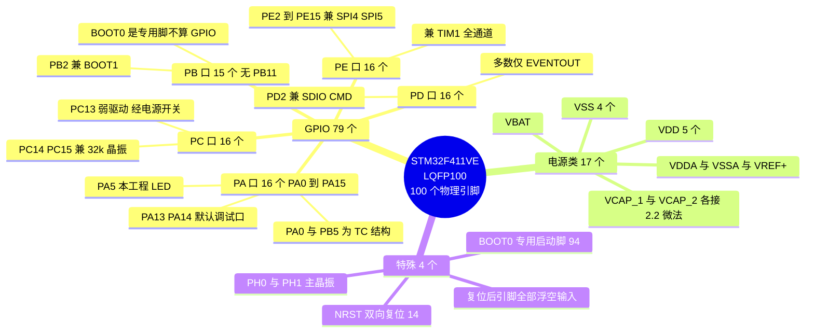
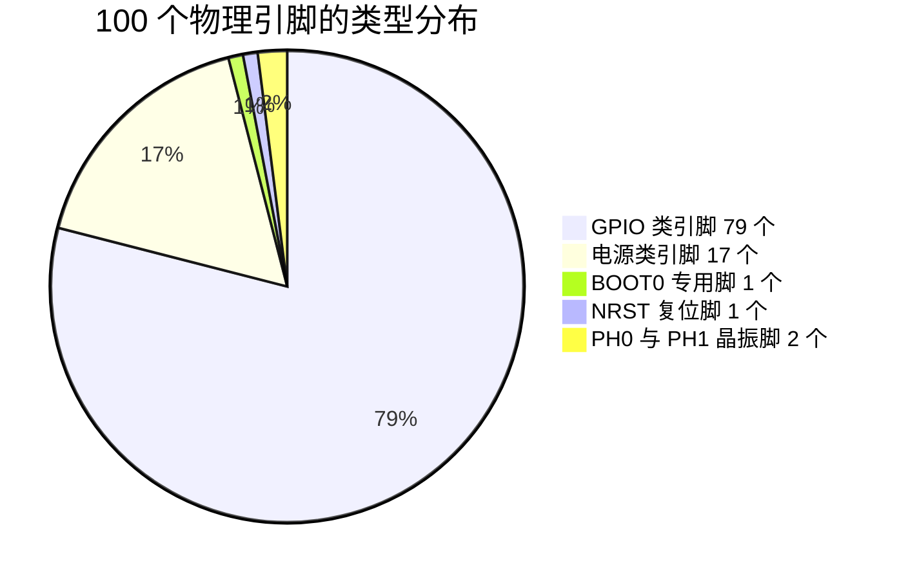
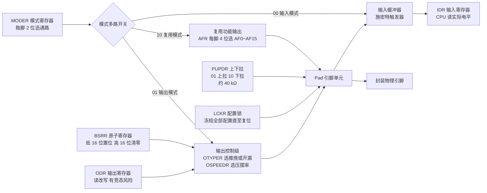
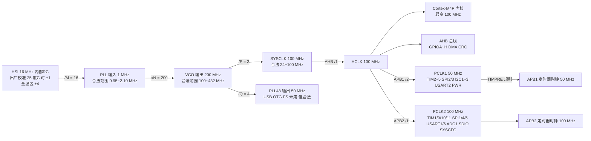
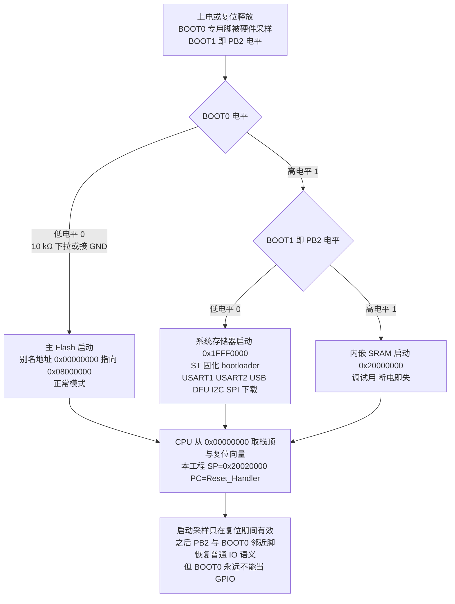
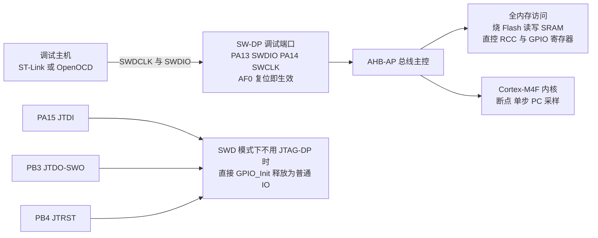
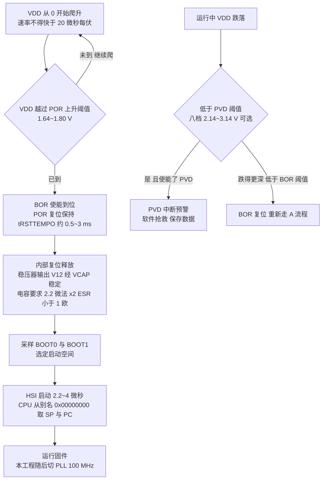
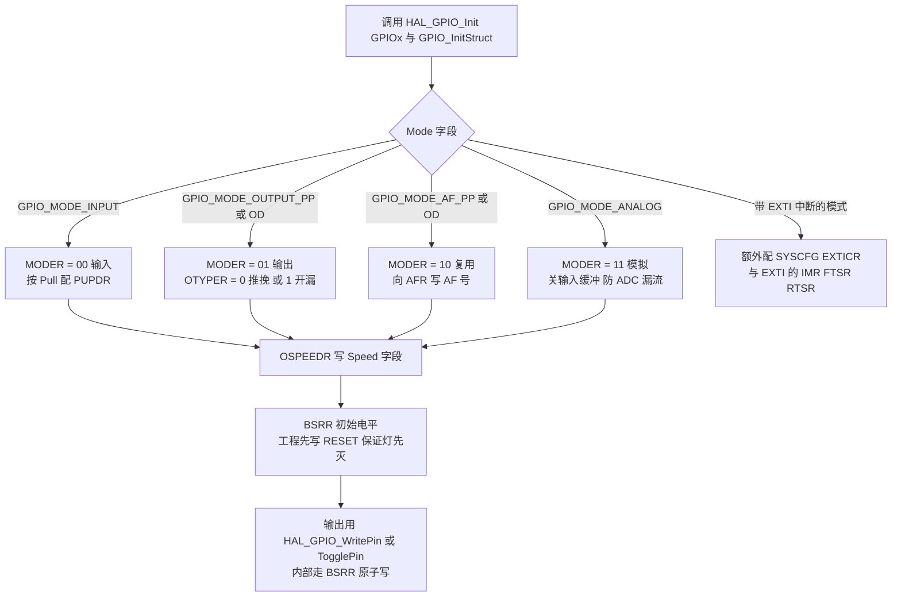
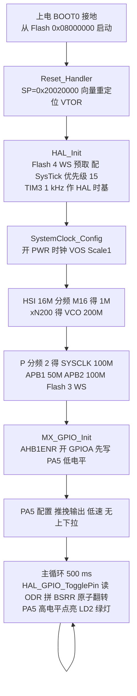

# STM32F411VE 引脚配置与使能 · 超级详细指南

> **数据来源**：ST 官方数据手册 **DS10314 Rev 8**《STM32F411xC/xE Datasheet》（151 页，纯文本副本位于 `/tmp/stm32ds/stm32f411ve.txt`，页码引用均为该 PDF 页号）；寄存器级细节交叉参考工程内 ST 官方 `stm32f4xx_hal_gpio_ex.h` / `stm32f411xe.h`（AF 编号定义）。
>
> **适用芯片**：STM32F411xC / STM32F411xE 家族。本仓库链接脚本为 `STM32F411xE_FLASH.ld`（512 KB Flash / 128 KB SRAM），对应 **STM32F411VE**；主引脚表以典型封装 **LQFP100（STM32F411VE）** 为准，LQFP64（Nucleo-F411RE 上的 STM32F411RET6）与 UFQFPN48 的差异在文中单列说明。
>
> **本仓库上下文**：`stm32f411-blink` 是裸机 + HAL 工程，板载 LED 接在 **PA5**（`Core/Inc/main.h` 中 `LED_PIN = GPIO_PIN_5`、`LED_GPIO_PORT = GPIOA`，即 Nucleo-F411RE 的 LD2），时钟 HSI→PLL 100 MHz（`Core/Src/main.c`）。本文所有「如何使能」示例均与本工程代码逐行对齐。

---

## 目录

- [1. 芯片与引脚总览](#1-芯片与引脚总览)
- [2. 物理管脚布局图（LQFP100 俯视图）](#2-物理管脚布局图lqfp100-俯视图)
- [3. 全部 100 个物理引脚逐脚详解（LQFP100 主表）](#3-全部-100-个物理引脚逐脚详解lqfp100-主表)
- [4. GPIO 模式与寄存器详解](#4-gpio-模式与寄存器详解)
- [5. 时钟系统与外设使能](#5-时钟系统与外设使能)
- [6. 启动模式与 BOOT 配置](#6-启动模式与-boot-配置)
- [7. 复用功能 AF0~AF15 映射](#7-复用功能-af0af15-映射)
- [8. 调试口：SWD / JTAG 引脚](#8-调试口swd--jtag-引脚)
- [9. 电气特性](#9-电气特性)
- [10. 上电复位与 BOR/PVD](#10-上电复位与-borpvd)
- [11. 如何使能一个 GPIO：HAL / 寄存器 / LL / Arduino](#11-如何使能一个-gpiohal--寄存器--ll--arduino)
- [12. Blink 实战：本仓库 PA5 深度分析](#12-blink-实战本仓库-pa5-深度分析)
- [13. 常见坑 FAQ](#13-常见坑-faq)

---

## 1. 芯片与引脚总览

| 项目 | 参数 | 出处 |
| --- | --- | --- |
| 内核 | ARM Cortex-M4F（含 FPU 单精度 + DSP 指令） | DS10314 特性页 |
| 主频 | **最高 100 MHz**（须配 VOS Scale1 + Flash 3 WS） | Table 14，p.63 |
| Flash | **512 KB** @ 0x08000000（本工程 `STM32F411xE_FLASH.ld` 同值） | §5 存储映射，p.54 |
| SRAM | **128 KB** @ 0x20000000 | §5 存储映射，p.54 |
| 系统存储器（bootloader） | 0x1FFF0000 起 | Table 10，p.54 |
| 供电 VDD | **1.7 ~ 3.6 V**（F407 是 1.8~3.6 V，F411 更宽） | Table 14，p.63 |
| VBAT | 1.65 ~ 3.6 V（RTC 与备份寄存器后备） | Table 14，p.63 |
| ADC | ADC1，12 位，16 外部通道，2.4 Msps @VDD≥2.4 V | Table 14/§6.3.20 |
| 总线 | AHB /1 = 100 MHz；APB1 /2 = 50 MHz；APB2 /1 = 100 MHz | main.c 时钟配置 |
| 通信外设 | USART 1/2/6、I2C 1/2/3、SPI **1/2/3/4/5**（SPI4/SPI5 是 F411 新增亮点）、USB OTG FS、SDIO | §3 功能概述 |
| 定时器 | TIM1（高级）、TIM2~5（通用）、TIM9/10/11（基本） | §3 功能概述 |
| LQFP100 GPIO 数 | **79 个 GPIO**（PA0~15、PB0~10 与 PB12~15、PC0~15、PD0~15、PE0~15），另有 PH0/PH1 可作 IO | Table 8，p.39~47 |
| LQFP100 特有 | 双 VCAP 脚（VCAP_1=48、VCAP_2=73）；**PB11 在 LQFP100/LQFP64 上不存在**（仅 UFBGA100 引出） | Table 8，p.43 |
| Strapping | **BOOT0（专用脚，LQFP100 第 94 脚）** + PB2 附加功能 BOOT1 | Table 8，p.42/47 |
| 调试口 | SWD：PA13(SWDIO)/PA14(SWCLK)；JTAG 另占 PA15/PB3/PB4 | Table 8，p.45/46 |

### 1.1 引脚分类一图流



### 1.2 引脚类型占比



> 📌 数字细节：LQFP100 的 100 个物理脚 = **79 个 GPIO + PH0/PH1 2 个（通常当晶振）+ NRST + BOOT0 + 17 个电源类**。PB11 只有 UFBGA100 封装才有（Table 8 p.43 该行 LQFP100 列为空），从 F407 迁移过来的人最容易在这里踩空。

---

## 2. 物理管脚布局图（LQFP100 俯视图）

下图对应数据手册 **图 12（Figure 12. STM32F411xC/xE LQFP100 pinout，p.37）**。LQFP100 逆时针编号：左 1~25 → 底 26~50 → 右 51~75 → 顶 76~100，Pin 1 位于左上角（丝印圆点）。图中已标注每个脚在 Table 8 中的类型要点。


> 📌 LQFP64（STM32F411RE，Nucleo-F411RE 实焊封装）差异：**没有 PE 口**（PE2~PE15 全部不引出）、PD 口仅剩 PD2、没有独立 PH 口引出、**VCAP 只有 1 个脚（第 30 脚，接 4.7 µF）**。关键脚位对照（摘 Table 8 的 LQFP64 列与图 11，p.36）：1 VBAT、7 NRST、12 VSSA、13 VDDA/VREF+、21 **PA5**、60 BOOT0。一句话：**LQFP64 上的 PA5 是第 21 脚，LQFP100 上是第 30 脚**，主表引脚号在 LQFP64 上不可直接套用。

---

## 3. 全部 100 个物理引脚逐脚详解（LQFP100 主表）

下表整理自 DS10314 **Table 8「STM32F411xC/xE pin definitions」（p.39~47）**，引脚号已与 **图 12 LQFP100 pinout（p.37）** 逐脚核对一致。列含义：

| 缩写 | 含义 |
| --- | --- |
| 类型 `I/O` | 双向输入输出脚 |
| 类型 `S` | 电源/供电脚 |
| 类型 `I` | 仅输入（BOOT0 即此类） |
| 结构 `FT` | 5 V 容忍 IO（Five Volt Tolerant），Table 7，p.39 |
| 结构 `TC` | 标准 3.3 V IO（本封装仅 PA0 与 PB5） |
| 结构 `B` | 专用 BOOT0 脚 |
| 主功能 | 复位期间与复位后的默认功能；手册注明「未特别说明时所有 IO 复位后均为浮空输入」 |
| AF | 经 GPIOx_AFR 寄存器选择的复用功能；AF 号见第 7 章 |
| 附加功能 | 经外设寄存器直接使能的功能（ADC、VBUS 等），不走 AFR |

| 引脚 | 名称 | 类型 | 结构 | 主功能 | 复用功能（AF） | 附加功能 | 使用要点 |
| :-: | --- | :-: | :-: | --- | --- | --- | --- |
| 1 | PE2 | I/O | FT | PE2 | TRACECLK、SPI4_SCK/I2S4_CK、SPI5_SCK/I2S5_CK、EVENTOUT | — | SPI4/5 双栈脚，AF5 给 SPI4、AF6 给 SPI5（p.39） |
| 2 | PE3 | I/O | FT | PE3 | TRACED0、EVENTOUT | — | ETM 跟踪数据线 0 |
| 3 | PE4 | I/O | FT | PE4 | TRACED1、SPI4_NSS/I2S4_WS、SPI5_NSS/I2S5_WS、EVENTOUT | — | SPI4/5 片选 |
| 4 | PE5 | I/O | FT | PE5 | TRACED2、TIM9_CH1、SPI4_MISO、SPI5_MISO、EVENTOUT | — | TIM9_CH1 在这里（p.39） |
| 5 | PE6 | I/O | FT | PE6 | TRACED3、TIM9_CH2、SPI4_MOSI/I2S4_SD、SPI5_MOSI/I2S5_SD、EVENTOUT | — | TIM9_CH2 |
| 6 | VBAT | S | — | — | — | — | RTC/备份寄存器后备电源 1.65~3.6 V；不用时接 VDD 或 VDD 经二极管 |
| 7 | PC13 | I/O | FT | PC13-ANTI_TAMP | RTC_OUT、RTC_TS | RTC_AF1 | ⚠ 经备份域电源开关：输出 ≤2 MHz、负载 ≤30 pF、**禁止驱动 LED**（Table 8 注 2/3，p.47）；WeAct 小板 LED 挂此脚 |
| 8 | PC14-OSC32_IN | I/O | FT | OSC32_IN | — | OSC32_IN | 32.768 kHz 晶振输入；振荡模式下 FT 失效（注 4，p.47） |
| 9 | PC15-OSC32_OUT | I/O | FT | OSC32_OUT | — | OSC32_OUT | 32.768 kHz 晶振输出；同上 |
| 10 | VSS | S | — | — | — | — | 数字地 |
| 11 | VDD | S | — | — | — | — | 数字电源 1.7~3.6 V |
| 12 | PH0-OSC_IN | I/O | FT | OSC_IN | — | OSC_IN | 主晶振输入，HSE 4~26 MHz（Table 37，p.85）；旁路模式可输入 1~50 MHz |
| 13 | PH1-OSC_OUT | I/O | FT | OSC_OUT | — | OSC_OUT | 主晶振输出 |
| 14 | NRST | I/O | NRST 类 | NRST | — | EVENTOUT | ⚠ 双向复位脚：内嵌**永久**弱上拉 30~50 kΩ，<100 ns 毛刺被硬件滤除（§6.3.17，p.104）；建议对地 0.1 µF |
| 15 | PC0 | I/O | FT | PC0 | EVENTOUT | ADC1_IN10 | 干净通用 IO |
| 16 | PC1 | I/O | FT | PC1 | EVENTOUT | ADC1_IN11 | 干净通用 IO |
| 17 | PC2 | I/O | FT | PC2 | SPI2_MISO、I2S2ext_SD、EVENTOUT | ADC1_IN12 | SPI2 从输入 |
| 18 | PC3 | I/O | FT | PC3 | SPI2_MOSI/I2S2_SD、EVENTOUT | ADC1_IN13 | SPI2 主输出 |
| 19 | VDD | S | — | — | — | — | 数字电源 |
| 20 | VSSA/VREF- | S | — | — | — | — | ⚠ 模拟地：即使不用 ADC 也必须接 VSS |
| 21 | VREF+ | S | — | — | — | — | ADC 参考电压输入（LQFP100 独立引出；LQFP64 与 VDDA 合并） |
| 22 | VDDA | S | — | — | — | — | ⚠ 模拟电源：给 ADC/复位块/PLL/RC 供电，必须与 VDD 同电位并去耦 |
| 23 | PA0-WKUP | I/O | **TC** | PA0 | TIM2_CH1/TIM2_ETR、TIM5_CH1、USART2_CTS、EVENTOUT | ADC1_IN0、WKUP1 | TC 结构（非 FT 设计）；待机唤醒脚 |
| 24 | PA1 | I/O | FT | PA1 | TIM2_CH2、TIM5_CH2、SPI4_MOSI/I2S4_SD、USART2_RTS、EVENTOUT | ADC1_IN1 | SPI4 复用组之一 |
| 25 | PA2 | I/O | FT | PA2 | TIM2_CH3、TIM5_CH3、TIM9_CH1、I2S2_CKIN、USART2_TX、EVENTOUT | ADC1_IN2 | USART2 默认 TX |
| 26 | PA3 | I/O | FT | PA3 | TIM2_CH4、TIM5_CH4、TIM9_CH2、I2S2_MCK、USART2_RX、EVENTOUT | ADC1_IN3 | USART2 默认 RX |
| 27 | VSS | S | — | — | — | — | 数字地 |
| 28 | VDD | S | — | — | — | — | 数字电源 |
| 29 | PA4 | I/O | FT | PA4 | SPI1_NSS/I2S1_WS、SPI3_NSS/I2S3_WS、USART2_CK、EVENTOUT | ADC1_IN4 | SPI1/SPI3 双片选 |
| 30 | **PA5** | I/O | FT | PA5 | TIM2_CH1/TIM2_ETR、SPI1_SCK/I2S1_CK、EVENTOUT | ADC1_IN5 | ⭐ **本工程 LED 脚**：Nucleo-F411RE LD2 直驱高电平点亮；占用它即放弃 SPI1 的 PA5 侧 SCK（详见第 12 章） |
| 31 | PA6 | I/O | FT | PA6 | TIM1_BKIN、TIM3_CH1、SPI1_MISO、I2S2_MCK、SDIO_CMD、EVENTOUT | ADC1_IN6 | SDIO CMD 备选脚 |
| 32 | PA7 | I/O | FT | PA7 | TIM1_CH1N、TIM3_CH2、SPI1_MOSI/I2S1_SD、EVENTOUT | ADC1_IN7 | SPI1 MOSI |
| 33 | PC4 | I/O | FT | PC4 | EVENTOUT | ADC1_IN14 | 干净通用 IO |
| 34 | PC5 | I/O | FT | PC5 | EVENTOUT | ADC1_IN15 | 干净通用 IO |
| 35 | PB0 | I/O | FT | PB0 | TIM1_CH2N、TIM3_CH3、SPI5_SCK/I2S5_CK、EVENTOUT | ADC1_IN8 | SPI5 SCK 备选 |
| 36 | PB1 | I/O | FT | PB1 | TIM1_CH3N、TIM3_CH4、SPI5_NSS/I2S5_WS、EVENTOUT | ADC1_IN9 | SPI5 NSS 备选 |
| 37 | PB2 | I/O | FT | PB2 | EVENTOUT | **BOOT1** | ⚠ 启动采样脚：BOOT0=1 时决定进系统存储器还是 SRAM（§3.13，p.21）；数据手册未提及 nBOOT1 选项字节（那是 F0/F3/L4 的机制），F4 上由 PB2 电平直接决定 |
| 38 | PE7 | I/O | FT | PE7 | TIM1_ETR、EVENTOUT | — | TIM1 外部触发 |
| 39 | PE8 | I/O | FT | PE8 | TIM1_CH1N、EVENTOUT | — | 仅 TIM1 相关，干净 |
| 40 | PE9 | I/O | FT | PE9 | TIM1_CH1、EVENTOUT | — | TIM1 主通道 |
| 41 | PE10 | I/O | FT | PE10 | TIM1_CH2N、EVENTOUT | — | 干净 |
| 42 | PE11 | I/O | FT | PE11 | TIM1_CH2、SPI4_NSS/I2S4_WS、SPI5_NSS/I2S5_WS、EVENTOUT | — | SPI4/5 片选 |
| 43 | PE12 | I/O | FT | PE12 | TIM1_CH3N、SPI4_SCK/I2S4_CK、SPI5_SCK/I2S5_CK、EVENTOUT | — | SPI4/5 时钟 |
| 44 | PE13 | I/O | FT | PE13 | TIM1_CH3、SPI4_MISO、SPI5_MISO、EVENTOUT | — | SPI4/5 MISO |
| 45 | PE14 | I/O | FT | PE14 | TIM1_CH4、SPI4_MOSI/I2S4_SD、SPI5_MOSI/I2S5_SD、EVENTOUT | — | SPI4/5 MOSI |
| 46 | PE15 | I/O | FT | PE15 | TIM1_BKIN、EVENTOUT | — | TIM1 刹车输入 |
| 47 | PB10 | I/O | FT | PB10 | TIM2_CH3、I2C2_SCL、SPI2_SCK/I2S2_CK、I2S3_MCK、SDIO_D7、EVENTOUT | — | I2C2 主脚；bootloader 用它跑 I2C2 |
| 48 | VCAP_1 | S | — | — | — | — | ⚠ 内部 1.2 V 核心稳压器输出，接 2.2 µF 陶瓷电容（ESR<1 Ω，Table 16，p.66）；**绝不可浮空或外供电压** |
| 49 | VSS | S | — | — | — | — | 数字地 |
| 50 | VDD | S | — | — | — | — | 数字电源 |
| 51 | PB12 | I/O | FT | PB12 | TIM1_BKIN、I2C2_SMBA、SPI2_NSS/I2S2_WS、SPI4_NSS/I2S4_WS、SPI3_SCK/I2S3_CK、EVENTOUT | — | SPI2 片选；bootloader SPI2 之一 |
| 52 | PB13 | I/O | FT | PB13 | TIM1_CH1N、SPI2_SCK/I2S2_CK、SPI4_SCK/I2S4_CK、EVENTOUT | — | SPI2 时钟 |
| 53 | PB14 | I/O | FT | PB14 | TIM1_CH2N、SPI2_MISO、I2S2ext_SD、SDIO_D6、EVENTOUT | — | SPI2 MISO |
| 54 | PB15 | I/O | FT | PB15 | RTC_50Hz、TIM1_CH3N、SPI2_MOSI/I2S2_SD、SDIO_CK、EVENTOUT | RTC_REFIN | SPI2 MOSI；SDIO 时钟备选 |
| 55 | PD8 | I/O | FT | PD8 | — | — | 纯 GPIO（复用仅 EVENTOUT 未列），干净 |
| 56 | PD9 | I/O | FT | PD9 | — | — | 纯 GPIO，干净 |
| 57 | PD10 | I/O | FT | PD10 | — | — | 纯 GPIO，干净 |
| 58 | PD11 | I/O | FT | PD11 | — | — | 纯 GPIO，干净 |
| 59 | PD12 | I/O | FT | PD12 | TIM4_CH1、EVENTOUT | — | TIM4 通道 |
| 60 | PD13 | I/O | FT | PD13 | TIM4_CH2、EVENTOUT | — | TIM4 通道 |
| 61 | PD14 | I/O | FT | PD14 | TIM4_CH3、EVENTOUT | — | TIM4 通道 |
| 62 | PD15 | I/O | FT | PD15 | TIM4_CH4、EVENTOUT | — | TIM4 通道 |
| 63 | PC6 | I/O | FT | PC6 | TIM3_CH1、I2S2_MCK、USART6_TX、SDIO_D6、EVENTOUT | — | USART6 默认 TX |
| 64 | PC7 | I/O | FT | PC7 | TIM3_CH2、SPI2_SCK/I2S2_CK、I2S3_MCK、USART6_RX、SDIO_D7、EVENTOUT | — | USART6 默认 RX |
| 65 | PC8 | I/O | FT | PC8 | TIM3_CH3、USART6_CK、SDIO_D0、EVENTOUT | — | SDIO 数据线 |
| 66 | PC9 | I/O | FT | PC9 | MCO_2、TIM3_CH4、I2C3_SDA、I2S2_CKIN、SDIO_D1、EVENTOUT | — | MCO2 时钟输出脚 |
| 67 | PA8 | I/O | FT | PA8 | MCO_1、TIM1_CH1、I2C3_SCL、USART1_CK、USB_FS_SOF、SDIO_D1、EVENTOUT | — | MCO1 输出脚；I2C3 时钟 |
| 68 | PA9 | I/O | FT | PA9 | TIM1_CH2、I2C3_SMBA、USART1_TX、EVENTOUT | OTG_FS_VBUS | USART1 默认 TX；bootloader 下载脚 |
| 69 | PA10 | I/O | FT | PA10 | TIM1_CH3、SPI5_MOSI/I2S5_SD、USART1_RX、USB_FS_ID、EVENTOUT | — | USART1 默认 RX；OTG 使能时内部上拉变 7~14 kΩ（Table 53，p.99） |
| 70 | PA11 | I/O | FT | PA11 | TIM1_CH4、SPI4_MISO、USART1_CTS、USB_FS_DM、EVENTOUT | — | ⚠ USB OTG FS 的 D-；bootloader USB DFU 之一 |
| 71 | PA12 | I/O | FT | PA12 | TIM1_ETR、SPI5_MISO、USART1_RTS、USB_FS_DP、EVENTOUT | — | ⚠ USB OTG FS 的 D+ |
| 72 | PA13 | I/O | FT | **JTMS-SWDIO** | EVENTOUT | — | ⚠ SWD 数据脚：复位后即为 AF0 调试功能，调试期勿挪用 |
| 73 | VCAP_2 | S | — | — | — | — | 同 VCAP_1，接 2.2 µF；LQFP100 双 VCAP 都要接 |
| 74 | VSS | S | — | — | — | — | 数字地 |
| 75 | VDD | S | — | — | — | — | 数字电源 |
| 76 | PA14 | I/O | FT | **JTCK-SWCLK** | EVENTOUT | — | ⚠ SWD 时钟脚：同 PA13，调试期勿挪用 |
| 77 | PA15 | I/O | FT | JTDI | TIM2_CH1/TIM2_ETR、SPI1_NSS/I2S1_WS、SPI3_NSS/I2S3_WS、USART1_TX、EVENTOUT | — | JTAG 数据输入；不用 JTAG-DP 时可释放为 GPIO |
| 78 | PC10 | I/O | FT | PC10 | SPI3_SCK/I2S3_CK、SDIO_D2、EVENTOUT | — | SPI3 时钟 |
| 79 | PC11 | I/O | FT | PC11 | I2S3ext_SD、SPI3_MISO、SDIO_D3、EVENTOUT | — | SPI3 MISO |
| 80 | PC12 | I/O | FT | PC12 | SPI3_MOSI/I2S3_SD、SDIO_CK、EVENTOUT | — | SPI3 MOSI |
| 81 | PD0 | I/O | FT | PD0 | EVENTOUT | — | 几乎零复用的干净脚，做 LED/按键优选 |
| 82 | PD1 | I/O | FT | PD1 | EVENTOUT | — | 同上，干净 |
| 83 | PD2 | I/O | FT | PD2 | TIM3_ETR、SDIO_CMD、EVENTOUT | — | SDIO 默认 CMD；LQFP64 上唯一的 PD 口脚 |
| 84 | PD3 | I/O | FT | PD3 | SPI2_SCK/I2S2_CK、USART2_CTS、EVENTOUT | — | SPI2 时钟备选 |
| 85 | PD4 | I/O | FT | PD4 | USART2_RTS、EVENTOUT | — | USART2 流控 |
| 86 | PD5 | I/O | FT | PD5 | USART2_TX、EVENTOUT | — | USART2 备选 TX；bootloader 支持 |
| 87 | PD6 | I/O | FT | PD6 | SPI3_MOSI/I2S3_SD、USART2_RX、EVENTOUT | — | USART2 备选 RX；bootloader 支持 |
| 88 | PD7 | I/O | FT | PD7 | USART2_CK、EVENTOUT | — | USART2 同步时钟 |
| 89 | PB3 | I/O | FT | **JTDO-SWO** | TIM2_CH2、SPI1_SCK/I2S1_CK、SPI3_SCK/I2S3_CK、USART1_RX、I2C2_SDA、EVENTOUT | — | ⚠ JTAG 输出/SWO 跟踪；释放后是 SPI1/SPI3 时钟的重要备选 |
| 90 | PB4 | I/O | FT | **JTRST** | TIM3_CH1、SPI1_MISO、SPI3_MISO、I2S3ext_SD、I2C3_SDA、SDIO_D0、EVENTOUT | — | ⚠ JTAG 复位；释放后作 I2C3 SDA 或 SPI MISO |
| 91 | PB5 | I/O | **TC** | PB5 | TIM3_CH2、I2C1_SMBA、SPI1_MOSI/I2S1_SD、SPI3_MOSI/I2S3_SD、SDIO_D3、EVENTOUT | — | TC 结构（非 FT）；SPI1/SPI3 MOSI 备选 |
| 92 | PB6 | I/O | FT | PB6 | TIM4_CH1、I2C1_SCL、USART1_TX、EVENTOUT | — | I2C1 时钟；bootloader I2C1 之一 |
| 93 | PB7 | I/O | FT | PB7 | TIM4_CH2、I2C1_SDA、USART1_RX、SDIO_D0、EVENTOUT | — | I2C1 数据；bootloader I2C1 之一 |
| 94 | **BOOT0** | **I** | **B** | BOOT0 | — | **VPP** | ⚠⚠ 专用启动输入脚（**永远不能当 GPIO**）：复位采样决定启动模式；附加 VPP 允许最高 9 V 输入（Table 11，p.61）；硬件上必须下拉/接地，禁止浮空 |
| 95 | PB8 | I/O | FT | PB8 | TIM10_CH1、I2C1_SCL、SPI5_MOSI/I2S5_SD、I2C3_SDA、SDIO_D4、EVENTOUT | — | I2C1 复用组 |
| 96 | PB9 | I/O | FT | PB9 | TIM11_CH1、I2C1_SDA、SPI2_NSS/I2S2_WS、I2C2_SDA、SDIO_D5、EVENTOUT | — | I2C1 复用组 |
| 97 | PE0 | I/O | FT | PE0 | TIM4_ETR、EVENTOUT | — | 干净 |
| 98 | PE1 | I/O | FT | PE1 | EVENTOUT | — | 几乎零复用的干净脚 |
| 99 | VSS | S | — | — | — | — | 数字地 |
| 100 | VDD | S | — | — | — | — | 数字电源 |

> ⚠ 提取说明：本表逐行摘自 PDF 纯文本的 Table 8（p.39~47），个别行的列有交错（如 PA8 行的 SDIO_D1、PB15 行的 SDIO_CK 等备选 SDIO 复用），极少数碎片归属以手册原表为准；引脚号与名称已经图 12（p.37）逐一交叉核对，主信号（USART/I2C/SPI/TIM/USB/SDIO 主用脚）与 §3.13 bootloader 的引脚清单（p.21）完全吻合。

---

## 4. GPIO 模式与寄存器详解

STM32F4 的每个 GPIO 端口是一组 32 位寄存器（基址见 Table 10，p.55：GPIOA=0x4002 0000、GPIOB=0x4002 0400、GPIOC=0x4002 0800、GPIOD=0x4002 0C00、GPIOE=0x4002 1000、GPIOH=0x4002 1C00），工程内 `Drivers/CMSIS/Device/ST/STM32F4xx/Include/stm32f411xe.h` 的 `GPIO_TypeDef` 与此一致：

| 偏移 | 寄存器 | 作用 | 关键位 |
| :-: | --- | --- | --- |
| 0x00 | **MODER** | 模式选择，每脚 2 位 | `00` 输入、`01` 输出、`10` 复用、`11` 模拟 |
| 0x04 | **OTYPER** | 输出类型，每脚 1 位 | `0` 推挽 PP、`1` 开漏 OD |
| 0x08 | **OSPEEDR** | 输出速度，每脚 2 位 | `00` 低 2 MHz、`01` 中、`10` 高、`11` 极高（见下表） |
| 0x0C | **PUPDR** | 上下拉，每脚 2 位 | `00` 无、`01` 上拉、`10` 下拉、`11` 保留 |
| 0x10 | **IDR** | 输入数据（只读） | 读实际引脚电平 |
| 0x14 | **ODR** | 输出数据 | 读改写方式输出；多任务下有竞态风险 |
| 0x18 | **BSRR** | 原子置位/复位 | 低 16 位写 1 置位、高 16 位写 1 清 0；一次写两个半字互不干扰 |
| 0x1C | **LCKR** | 配置锁 | bit16=LCKK；按 `1-0-1-0-1` 顺序写 bit0~15 再读 LCKK 冻结配置直至复位 |
| 0x20/0x24 | **AFR[2]** | 复用选择，每脚 4 位 | AFRL=脚 0~7、AFRH=脚 8~15，值即 AF 号（0~15） |

GPIO 时钟在 **RCC->AHB1ENR**（GPIOA=bit0 … GPIOE=bit4、GPIOH=bit7）——**不开时钟，所有寄存器写入无效**，这是 STM32 第一大坑。

### 4.1 信号路径一图流



### 4.2 OSPEEDR 速度档位（Table 55，p.102~103）

| OSPEEDRy | HAL 宏 | 典型最高翻转频率 | 说明 |
| :-: | --- | :-: | --- |
| 00 低 | `GPIO_SPEED_FREQ_LOW` | 2 MHz @50 pF；8 MHz @10 pF、VDD≥2.7 V | LED/继电器/慢信号首选，EMI 最小 |
| 01 中 | `GPIO_SPEED_FREQ_MEDIUM` | 12.5 MHz @50 pF；50 MHz @10 pF、VDD≥2.7 V | 中速数字信号 |
| 10 高 | `GPIO_SPEED_FREQ_HIGH` | 25~50 MHz（随负载与 VDD） | 高速总线 |
| 11 极高 | `GPIO_SPEED_FREQ_VERY_HIGH` | 50~**100 MHz** @10 pF、VDD≥2.7 V | ⚠ >50 MHz 且 VDD>2.4 V 时**必须使能补偿单元**（SYSCFG_CMPCR，CMPCR 寄存器 CMP_PD=1 后等 READY，p.103 注 4） |

> 📌 本工程 LED 用的是 `GPIO_SPEED_FREQ_LOW`（OSPEEDR=00）——点灯不需要速度，选低档能把边沿放缓、EMI 最低，还能省电。

### 4.3 复位后的默认状态

- **所有 GPIO**：MODER=输入（00）、OTYPER=推挽、OSPEEDR=低、PUPDR=无上下拉（**浮空输入**），Table 7 明确注明（p.39）。
- **PA13/PA14**：复位后直接进入 AF0 = JTMS-SWDIO / JTCK-SWCLK（调试可用）。
- **PA15/PB3/PB4**：复位后为 AF0 = JTDI / JTDO-SWO / JTRST（JTAG 五针的另外三根）。
- **BOOT0**：专用输入，不进 GPIO 矩阵。
- **模拟外设共用脚（ADC 通道）**：要用 ADC 必须 `MODER=11`（模拟模式），否则数字输入缓冲会引入漏电流。

---

## 5. 时钟系统与外设使能

### 5.1 本工程时钟树（main.c 完整走读）

`Core/Src/main.c` 的 `SystemClock_Config()`（第 41~78 行）实现了教科书级的「无晶振 100 MHz」方案：

| 步骤 | 代码 | 值 | 手册依据 |
| :-: | --- | --- | --- |
| 1 | `__HAL_RCC_PWR_CLK_ENABLE()` | 开 APB1 上的 PWR 时钟（AHB1ENR/APB1ENR，README 逆向显示 `APB1ENR \|= 0x10000000` 即 bit28） | RCC 章节 |
| 2 | `__HAL_PWR_VOLTAGESCALING_CONFIG(PWR_REGULATOR_VOLTAGE_SCALE1)` | PWR_CR.VOS[1:0]=11，核心电压调到 Scale1 档 1.26~1.38 V（典型 1.32 V） | Table 14，p.63 |
| 3 | `RCC_OscInitStruct.PLL.PLLSource = RCC_PLLSOURCE_HSI` | HSI 16 MHz 内部 RC 作 PLL 输入，**无需外部晶振** | Table 39，p.87 |
| 4 | `PLLM = 16` | 16/16 = **1 MHz** VCO 输入（合法 0.95~2.10 MHz） | Table 41，p.89 |
| 5 | `PLLN = 200` | 1 MHz × 200 = **200 MHz** VCO 输出（合法 100~432 MHz） | Table 41，p.89 |
| 6 | `PLLP = RCC_PLLP_DIV2` | 200/2 = **SYSCLK 100 MHz**（合法 24~100 MHz） | Table 41，p.89 |
| 7 | `PLLQ = 4` | 200/4 = 50 MHz PLL48 输出（合法 48~75 MHz）；USB 未用但值合法 | Table 41，p.89 |
| 8 | `SYSCLKSource = RCC_SYSCLKSOURCE_PLLCLK` | 切系统时钟到 PLL | — |
| 9 | `AHBCLKDivider = RCC_SYSCLK_DIV1` | HCLK = 100 MHz | — |
| 10 | `APB1CLKDivider = RCC_HCLK_DIV2` | PCLK1 = 50 MHz（APB1 硬上限） | Table 14，p.63 |
| 11 | `APB2CLKDivider = RCC_HCLK_DIV1` | PCLK2 = 100 MHz（APB2 硬上限） | Table 14，p.63 |
| 12 | `HAL_RCC_ClockConfig(..., FLASH_LATENCY_3)` | Flash 等待周期 3 WS | Table 15，p.65 |

> 📌 细节：`main.c` **文件头注释**写的 `N=100` 是历史笔误，函数体内的注释与实际代码、README 逆向结果均为 **N=200**（VCO 200 MHz ÷ P=2 = 100 MHz）。以代码为准。

**为什么必须是 Scale1 + LATENCY_3**：`fHCLK ≤ 100 MHz` 只在 `VOS[1:0]=11`（Scale1，核心 1.32 V）时成立；Scale2 只允许 84 MHz、Scale3 只允许 64 MHz（Table 14，p.63）。同时 Flash 在 VDD 2.7~3.6 V、100 MHz 下需要 **3 个等待周期**（Table 15，p.64~65）——两件事少一件，芯片就会跑飞或取指错误。本工程 VDD=3.3 V 正好落在 2.7~3.6 V 档。

### 5.2 时钟树图



### 5.3 外设时钟使能位速查（RCC，工程已验证的位）

| 总线 | 寄存器 | 本工程/常用使能位 | 位 |
| :-: | :-: | --- | :-: |
| AHB1 | `RCC->AHB1ENR` | GPIOA | 0 |
| AHB1 | `RCC->AHB1ENR` | GPIOB/GPIOC/GPIOD/GPIOE | 1/2/3/4 |
| AHB1 | `RCC->AHB1ENR` | GPIOH（PH0/PH1） | 7 |
| AHB1 | `RCC->AHB1ENR` | DMA1 / DMA2 | 21 / 22 |
| APB1 | `RCC->APB1ENR` | TIM3（HAL 时基用，`Config/stm32f4xx_hal_timebase.c`） | 1 |
| APB1 | `RCC->APB1ENR` | TIM2 / TIM4 / TIM5 | 0 / 2 / 3 |
| APB1 | `RCC->APB1ENR` | SPI2 / SPI3 | 14 / 15 |
| APB1 | `RCC->APB1ENR` | I2C1 / I2C2 / I2C3 | 21 / 22 / 23 |
| APB1 | `RCC->APB1ENR` | **PWR（配 VOS 前必须先开）** | 28 |
| APB2 | `RCC->APB2ENR` | TIM1 | 0 |
| APB2 | `RCC->APB2ENR` | USART1 / USART6 | 4 / 5 |
| APB2 | `RCC->APB2ENR` | ADC1 | 8 |
| APB2 | `RCC->APB2ENR` | SDIO | 11 |
| APB2 | `RCC->APB2ENR` | SPI1 / SPI4 | 12 / 13 |
| APB2 | `RCC->APB2ENR` | SYSCFG | 14 |
| APB2 | `RCC->APB2ENR` | SPI5 | 20 |

（位定义摘自工程 `stm32f411xe.h` 的 `RCC_APB2ENR_*_Pos` 等宏，与本工程反汇编结果一致。）

> 📌 **F411 没有 PLLI2S 输入引脚分歧的困扰，但有独立的 PLLI2S**（音频 PLL，Table 42，p.90），只喂 I2S 外设；主 PLL 与 PLLI2S 互不干扰。USB OTG FS 必须吃 48 MHz：F411 上 PLL48 由主 PLL 的 /Q 分频产生，**无法在 HSI 直驱 SYSCLK 时得到精确 48 MHz**（HSI ±1% 不满足 USB ±0.25% 容差）——要么用主 PLL Q 输出（如本工程 200/4=50 MHz 时 USB 未用；真要 USB 需调 N/Q 凑出 48 MHz，如 M=16、N=192、Q=4 → 192/4=48），要么 HSE+PLL。

---

## 6. 启动模式与 BOOT 配置

### 6.1 三种启动方式（§3.13，p.21）

复位释放的瞬间，硬件采样 **BOOT0（专用脚，LQFP100 第 94 脚）** 与 **BOOT1（PB2 的附加功能，Table 8，p.42）**，从三个地址空间之一启动：

| BOOT0 | BOOT1(PB2) | 启动空间 | 别名地址 | 用途 |
| :-: | :-: | --- | --- | --- |
| **0** | 任意 | **用户 Flash** 0x08000000 | 映射到 0x00000000 | ✅ 正常运行（本工程固件从 0x08000000 烧录） |
| 1 | **0** | **系统存储器** 0x1FFF0000 | 映射到 0x00000000 | 📥 串口/USB DFU bootloader（ST 出厂固化） |
| 1 | **1** | **内嵌 SRAM** 0x20000000 | 映射到 0x00000000 | 🔧 调试用，断电即失 |

系统存储器 bootloader 支持的下载接口（§3.13，p.21 原文清单）：**USART1(PA9/10)、USART2(PD5/6)、USB OTG FS 设备模式(PA11/12) 走 DFU、I2C1(PB6/7)、I2C2(PB10/3)、I2C3(PA8/PB4)、SPI1(PA4/5/6/7)、SPI2(PB12/13/14/15)、SPI3(PA15, PC10/11/12)**；详见 AN2606。

> 📌 **关于 nBOOT1**：F0/F3/L4 系列有 nBOOT1 选项字节；**F411 数据手册通篇没有 nBOOT1**（grep 全文仅 Table 8 中 PB2 行的附加功能 BOOT1，p.42）。F4 上 BOOT1 就是 PB2 的电平本身（需要时也可用 option byte 修改启动地址 BOOT_ADD，详见 RM0383/AN2606）。

### 6.2 BOOT 决策流程



### 6.3 与链接脚本的对照

| 数据手册（§5 存储映射，p.54） | `STM32F411xE_FLASH.ld` |
| --- | --- |
| Flash 0x08000000 ~ 0x0807FFFF（512 KB） | `FLASH (rx) : ORIGIN = 0x08000000, LENGTH = 512K` |
| SRAM 0x20000000 起 128 KB | `RAM (xrw) : ORIGIN = 0x20000000, LENGTH = 128K` |
| 栈顶即 SRAM 末 | `_estack = ORIGIN(RAM) + LENGTH(RAM)`（=0x20020000，README 逆向验证 .bin 前 4 字节正是它） |

> ✅ 启动链：`BOOT0=0` → Flash 别名到 0 → 取 SP=0x20020000 → `Reset_Handler`（startup_stm32f411xe.s 第 57~102 行）→ `SystemInit`（FPU 使能、VTOR=0x08000000）→ 拷 .data/清 .bss → `main` → `HAL_Init → SystemClock_Config → MX_GPIO_Init`。

---

## 7. 复用功能 AF0~AF15 映射

每个引脚的 AFR 4 位从 **16 条 AF 总线**中选一条。F411 的 AF 号定义与 ST 官方 `stm32f4xx_hal_gpio_ex.h`（`#if defined(STM32F411xE)` 块，工程内 817~920 行）一致，并与 DS10314 Table 9（p.48~53）对应：

| AF 号 | HAL 宏 | 承载外设 |
| :-: | --- | --- |
| AF0 | `GPIO_AF0_SWJ/_MCO/_TRACE/_RTC_50Hz/_TAMPER` | 系统：SWD/JTAG、MCO1/2、ETM 跟踪、RTC_50Hz、ANTI_TAMP |
| AF1 | `GPIO_AF1_TIM1/_TIM2` | TIM1、TIM2 |
| AF2 | `GPIO_AF2_TIM3/_TIM4/_TIM5` | TIM3、TIM4、TIM5 |
| AF3 | `GPIO_AF3_TIM9/_TIM10/_TIM11` | TIM9、TIM10、TIM11 |
| AF4 | `GPIO_AF4_I2C1/_I2C2/_I2C3` | I2C1、I2C2、I2C3 |
| AF5 | `GPIO_AF5_SPI1/_SPI2/_SPI3/_SPI4/_I2S3ext` | SPI1、SPI2、SPI3、**SPI4**、I2S1/2/3 |
| AF6 | `GPIO_AF6_SPI2(I2S2)/_SPI3/_SPI4/_SPI5/_I2S2ext` | I2S2、SPI3、SPI4、**SPI5**、I2S2ext |
| AF7 | `GPIO_AF7_USART1/_USART2/_SPI3/_I2S3ext` | USART1、USART2、SPI3 备选、I2S3ext |
| AF8 | `GPIO_AF8_USART6` | USART6 |
| AF9 | `GPIO_AF9_I2C2/_I2C3/_TIM14` | I2C2/I2C3 备选组、TIM14 |
| AF10 | `GPIO_AF10_OTG_FS` | USB OTG FS（DM/DP/ID/SOF） |
| AF11 | — | F411 未用 |
| AF12 | `GPIO_AF12_SDIO` | SDIO（CMD/CK/D0~D7） |
| AF13/14 | — | F411 未用 |
| AF15 | `GPIO_AF15_EVENTOUT` | EVENTOUT（经 EXTI 触发的事件输出脉冲） |

### 7.1 重点外设的可用引脚（摘自 Table 8 p.39~47，主用脚加粗）

**USART**

| 外设 | TX | RX | CK | CTS | RTS |
| --- | --- | --- | --- | --- | --- |
| USART1（AF7） | **PA9**、PB6、PA15 | **PA10**、PB7、PB3 | PA8 | PA11 | PA12 |
| USART2（AF7） | **PA2**、PD5 | **PA3**、PD6 | PA4、PD7 | PA0、PD3 | PA1、PD4 |
| USART6（AF8） | **PC6**、PA11 | **PC7**、PA12 | PC8 | — | — |

**I2C**（开漏输出由硬件强制；F411 的 SDA/SCL 脚不是「真」开漏，见 p.105 注）

| 外设 | SCL | SDA | SMBA |
| --- | --- | --- | --- |
| I2C1（AF4） | **PB6**、PB8 | **PB7**、PB9 | PB5 |
| I2C2（AF4/AF9） | **PB10**(AF4) | **PB3**(AF9)、PB11 仅 UFBGA100 | PB12 |
| I2C3（AF4/AF9） | **PA8** | **PC9**、PB4 | PA9 |

**SPI / I2S**（F411 亮点：五个 SPI，其中 SPI4/SPI5 是新增）

| 外设 | NSS | SCK | MISO | MOSI | 挂在哪条总线 |
| --- | --- | --- | --- | --- | --- |
| SPI1（AF5） | PA4、PA15 | **PA5**、PB3 | PA6、PB4 | PA7、PB5 | APB2，最高 50 MHz |
| SPI2/I2S2（AF5/AF6） | PB12、PB9 | **PB13**、PB10、PD3 | PB14、PC2 | PB15、PC3 | APB1，最高 25 MHz |
| SPI3/I2S3（AF6，部分脚 AF5/AF7） | PA4、PA15 | **PC10**、PB3 | PC11、PB4 | PC12、PB5、PD6 | APB1，最高 25 MHz |
| **SPI4/I2S4（AF5，PA 侧复用组在 AF6）** | PE4、PE11 | **PE12**、PE2 | PE13、PE5、PA11 | PE14、PE6、PA1 | APB2，最高 50 MHz |
| **SPI5/I2S5（AF6）** | PE4、PE11、PB1 | **PE12**、PE2、PB0 | PE13、PE5、PA12 | PE14、PE6、PB8、PA10 | APB2，最高 50 MHz |

**定时器**

| 定时器 | 可用通道引脚（摘 Table 8） |
| --- | --- |
| TIM1（AF1，APB2，100 MHz） | CH1：PA8/PE9；CH2：PA9/PE11；CH3：PA10/PE13；CH4：PA11/PE14；CH1N：PA7/PE8/PB13；CH2N：PB14/PE10；CH3N：PB15/PE12；BKIN：PA6/PB12/PE15；ETR：PE7/PA12 |
| TIM2（AF1，APB1，50 MHz） | CH1/ETR：PA0/PA5/PA15；CH2：PA1/PB3；CH3：PA2/PB10；CH4：PA3 |
| TIM3（AF2，APB1） | CH1：PA6/PB4/PC6；CH2：PA7/PB5/PC7；CH3：PB0/PC8；CH4：PB1/PC9；ETR：PD2 |
| TIM4（AF2，APB1） | CH1：PB6/PD12；CH2：PB7/PD13；CH3：PB8/PD14；CH4：PB9/PD15；ETR：PE0 |
| TIM5（AF2，APB1） | CH1~CH4：PA0~PA3 |
| TIM9（AF3） | CH1：PA2/PE5；CH2：PA3/PE6 |
| TIM10（AF3） | CH1：PB8 |
| TIM11（AF3） | CH1：PB9 |

**USB OTG FS（AF10）**：DM=PA11、DP=PA12、ID=PA10、SOF=PA8；VBUS 检测为 PA9 的附加功能（非 AF）。VDD 需 ≥2.7 V（Table 15 注 6，p.65），且必须给 PLL48 恰好 48 MHz。

**SDIO（AF12）**：CMD=PA6/PD2、CK=PC12、D0=PC8、D1=PC9、D2=PC10、D3=PC11、D4=PB8、D5=PB9、D6=PC6/PB14、D7=PC7/PB10。

> 📌 FM+ 说明：DS10314 原文写明 I2C 支持 Standard 100 kHz、Fast 400 kHz，且「I2C 总线频率可以提高到 1 MHz」（p.105）——但手册中**没有 FM+（Fast-mode Plus）条目**，1 MHz 属于超出规范模式的“可运行”表述，工程上建议按 400 kHz 设计裕量。跨厂商接线时若对方宣称 FM+，需自行验证时序。

---

## 8. 调试口：SWD / JTAG 引脚

| 信号 | 引脚 | 复位后状态 | 说明 |
| --- | :-: | --- | --- |
| **SWDIO**（JTMS） | **PA13**（LQFP100 第 72 脚） | AF0，主功能即 JTMS-SWDIO | SWD 数据；复位后立即可用 |
| **SWCLK**（JTCK） | **PA14**（第 76 脚） | AF0，主功能即 JTCK-SWCLK | SWD 时钟 |
| JTDI | PA15（第 77 脚） | AF0 | JTAG 专用；SWD 模式下可释放为 GPIO |
| JTDO / SWO | PB3（第 89 脚） | AF0 | SWO 跟踪输出或 GPIO |
| JTRST | PB4（第 90 脚） | AF0 | JTAG 复位；SWD 不用，可释放 |

### 8.1 SWD 调试链路与释放规则



释放要点（F4 与 F0/L4 不同，**没有 SYSCFG「禁用 JTAG」开关**）：

1. SWD 只用 PA13/PA14，其余三根（PA15/PB3/PB4）在复位后虽处于 AF0 调试功能，但**只要不连接 JTAG 探针、软件把它们配置成 GPIO 输出/输入即可**——`HAL_GPIO_Init` 改写 MODER 后数字通路立即切换，无需额外寄存器。
2. 调试期间**永远别动 PA13/PA14**，否则一烧录一复位就失联（只能 BOOT0 进系统存储器救砖）。
3. 若要 SWO 跟踪，保留 PB3 为 AF0（JTDO-SWO）并在调试器侧接 SWO 线。
4. 本工程当前没有使用 PA13/PA14/PB3/PB4/PA15，全部处于复位默认态。

---

## 9. 电气特性

### 9.1 电压范围（DS10314 §6，重点表格）

| 参数 | 值 | 出处 |
| --- | --- | :-: |
| VDD 运行电压 | **1.7 ~ 3.6 V**（典型 3.3 V） | Table 14，p.63 |
| VDDA/VSSA | 必须与 VDD/VSS 同电位（1.7~3.6 V）；ADC 采样率受 VDD 限制：<2.4 V 时 1.2 Msps，≥2.4 V 时 2.4 Msps | Table 14，p.63 |
| VBAT | 1.65 ~ 3.6 V | Table 14，p.63 |
| VDD 绝对最大 | −0.3 ~ **4.0 V** | Table 11，p.61 |
| FT/TC 引脚输入绝对最大 | VSS−0.3 ~ **VDD+4.0 V** | Table 11，p.61 |
| 其他引脚输入绝对最大 | VSS−0.3 ~ 4.0 V | Table 11，p.61 |
| **BOOT0 输入** | 最高 **9.0 V**（VPP 编程电压路径） | Table 11，p.61 |
| FT/TC 运行输入上限 | VDD≥2 V：−0.3~5.5 V；VDD<2 V：−0.3~5.2 V | Table 14，p.63 |
| 核心稳压器 V12（VCAP 上） | Scale1：1.26~1.38 V（典型 1.32）；Scale2：1.26 顶格 84 MHz；Scale3：1.08~1.20（64 MHz） | Table 14，p.63 |

> 💡 **与 F407 的关键差异**：F407 的 VDD 范围是 1.8~3.6 V，**F411 把下限压到了 1.7 V**（代价是外设精简：无 DAC、无 Camera、TIM 只有 8 个）。1.7 V 运行要求配合外部供电监视器（§3.15.2 内部复位 OFF 模式），常规设计仍按 1.8 V 以上使用。

### 9.2 引脚直流特性（Table 53/54，p.98~101）

| 参数 | 条件 | 值 |
| --- | --- | --- |
| VIL 输入低 | FT/TC/NRST，1.7~3.6 V | ≤ 0.3×VDD |
| VIH 输入高 | 同上 | ≥ 0.7×VDD |
| 迟滞 HYS | — | ≥ 200 mV（约 10%VDD） |
| VOL 输出低 | IIO=+8 mA | ≤ 0.4 V |
| VOH 输出高 | IIO=8 mA，2.7~3.6 V | ≥ VDD−0.4 V |
| VOL/VOH（大电流） | IIO=20 mA，2.7~3.6 V | 压降 1.3 V（**由特性化保证，非产测**） |
| 弱上拉 RPU | VDD=VSS | 30 / 40 / 50 kΩ（min/typ/max） |
| 弱下拉 RPD | VIN=VDD | 30 / 40 / 50 kΩ |
| PA10 特殊 | OTG 使能时 | 上拉变 7~14 kΩ（USB ID 处理） |
| 引脚电容 CIO | — | ≤ 5 pF |
| FT 脚 5 V 输入漏流 | VIN=5 V | ≤ 3 µA |
| I/O 输入漏流 | VSS≤VIN≤VDD | ±1 µA |

### 9.3 电流限制（Table 12，p.62 —— 绝对最大）

| 参数 | 限制 |
| --- | :-: |
| 单个 I/O 输出灌/拉电流 IIO | **±25 mA** |
| 所有 I/O 合计 ΣIIO | ±120 mA |
| 每条 VDD 电源脚电流 | 100 mA |
| 所有 VDD 合计 | 160 mA |
| 每条 VSS 地脚电流 | −100 mA（灌） |
| 所有 VSS 合计 | −160 mA |
| 注入电流（FT/TC 脚） | −5 / +0 mA（正注入被 VDD 钳位二极管阻断，不可能发生） |
| 注入电流（NRST/BOOT0） | 以 Table 12 原表为准（提取行交错）；Table 52 显示两者负注入容忍为 0 |
| 总注入 ΣIINJ | ±25 mA |

**FT 与 TC 的本质**：FT = 5 V 容忍（内部无上钳位到 VDD 的二极管，靠隔离结构），TC = 标准 3.3 V IO。LQFP100 上**只有 PA0 与 PB5 是 TC**，其余全部 FT——接 5 V 外设时优先挑 FT 脚；PA0/PB5 老老实实用 3.3 V 电平。

**I/O 注入敏感性**（Table 52，p.97）：BOOT0、NRST、PB3~PB9、PC0~PC3、PC13~PC15、PD1、PD5~PD7、PE0、PE2~PE6、PH1 这组脚负注入容忍为 0（会扰动 ADC/触发复位）；其余 FT 脚 −5 mA；「any other pins」−5/+5 mA。模拟脚建议加肖特基二极管到地防负注入（p.98 注）。

---

## 10. 上电复位与 BOR/PVD

### 10.1 阈值参数（Table 19，p.67~68）

| 参数 | 典型值 | 说明 |
| --- | --- | --- |
| POR/PDR 上升阈值 | 1.72 V（1.64~1.80） | VDD 爬过它才开始放行复位 |
| POR/PDR 下降阈值 | 1.68 V（1.60~1.76） | 掉电回滞 40 mV |
| POR 复位脉冲 TRSTTEMPO | 0.5~1.5 ms（最大 3 ms） | 内部复位保持时间 |
| BOR1（默认复位级） | 上升 2.29 V / 下降 2.19 V | 选项字节可配 BOR0~BOR3 |
| BOR2 | 上升 2.59 / 下降 2.50 | |
| BOR3 | 上升 2.92 / 下降 2.83 | |
| BOR 回滞 | 100 mV | |
| PVD 八档（PLS[2:0]=000~111） | 上升 2.14 → 3.14 V，步进约 0.2 V | PVD 是**中断/事件**不是复位，VDD 跌破阈值时给软件预警 |
| PVD 回滞 | 100 mV | |
| 稳压器 in-rush | 160~200 mA | 上电瞬间对 VDD 的冲击，电源要扛得住 |
| VDD 爬升速率 | 20 µs/V ~ ∞ | **不能快于 20 µs/V**（Table 17，p.66） |

### 10.2 上电时序图



> 📌 NRST 脚的补充（§6.3.17，p.104）：内嵌永久弱上拉 30~50 kΩ；**<100 ns 的窄脉冲被滤除**，≥300 ns（VDD>2.7 V）才触发内部复位；内部复位脉冲持续 20 µs；推荐 NRST 对地 0.1 µF。VCAP 没接电容（或容量不够/ESR 过大）时，核心电压失稳 → 复位循环或随机跑飞，且**从外部看一切正常**——这是 F4 板子“玄学复位”的头号原因。

---

## 11. 如何使能一个 GPIO：HAL / 寄存器 / LL / Arduino

### 11.0 先理解约束顺序

1. **开 GPIO 端口时钟**（RCC->AHB1ENR）——不开时钟写任何 GPIO 寄存器都无效。
2. **配 PWR 电压档**（要用 100 MHz 时）——PWR 时钟先开，再设 VOS。
3. **配 MODER/OTYPER/OSPEEDR/PUPDR**（HAL_GPIO_Init 一次做完）。
4. **用 BSRR 输出**（原子操作），别用 ODR 读改写。



### 11.1 HAL 级（本工程 main.c 第 84~97 行，逐行讲）

```c
static void MX_GPIO_Init(void)
{
  GPIO_InitTypeDef GPIO_InitStruct = {0};

  LED_GPIO_CLK_ENABLE();                 /* __HAL_RCC_GPIOA_CLK_ENABLE()：
                                            RCC->AHB1ENR |= GPIOAEN(bit0)，不开时钟后面全白写 */

  HAL_GPIO_WritePin(LED_GPIO_PORT, LED_PIN, GPIO_PIN_RESET);
  /* 先写初始电平再改模式！写 BSRR 高 16 位 bit5=1 → PA5 清 0（灯灭），
     避免“先成输出再拉低”造成的上电瞬间 LED 闪一下 */

  GPIO_InitStruct.Pin   = LED_PIN;              /* GPIO_PIN_5 = 0x0020 */
  GPIO_InitStruct.Mode  = GPIO_MODE_OUTPUT_PP;  /* MODER5=01 输出，OTYPER5=0 推挽 */
  GPIO_InitStruct.Pull  = GPIO_NOPULL;          /* PUPDR5=00 浮空（输出态无所谓） */
  GPIO_InitStruct.Speed = GPIO_SPEED_FREQ_LOW;  /* OSPEEDR5=00 低速，EMI 最小 */
  HAL_GPIO_Init(LED_GPIO_PORT, &GPIO_InitStruct);
}
```

`HAL_GPIO_TogglePin` 的原子性（README 反汇编已验证）：读 `ODR`（+0x14）→ 把本脚位从高/低半字分开 → 拼成一个 BSRR 字 → 写 `BSRR`（+0x18）。**一次写同时置位与复位，无读改写竞态**——中断/任务并发下必须走这条路。

### 11.2 寄存器级（裸机等价片段）

```c
/* 1. 开 GPIOA 时钟 */
RCC->AHB1ENR |= RCC_AHB1ENR_GPIOAEN;          /* bit0 */
(void)RCC->AHB1ENR;                            /* 读回一小段延时，确保时钟真正起来 */

/* 2. 配 PA5：输出、推挽、低速、无上下拉 */
GPIOA->MODER   &= ~GPIO_MODER_MODER5;          /* 清两位 */
GPIOA->MODER   |=  GPIO_MODER_MODER5_0;        /* 01 = 输出 */
GPIOA->OTYPER  &= ~GPIO_OTYPER_OT_5;           /* 0 = 推挽 */
GPIOA->OSPEEDR &= ~GPIO_OSPEEDR_OSPEEDR5;      /* 00 = 低速 */
GPIOA->PUPDR   &= ~GPIO_PUPDR_PUPDR5;          /* 00 = 无上下拉 */

/* 3. 输出：只动 PA5，不惊扰其他脚 */
GPIOA->BSRR = GPIO_BSRR_BR5;                   /* 高16位 bit5 写 1 → 输出低（灯灭） */
GPIOA->BSRR = GPIO_BSRR_BS5;                   /* 低16位 bit5 写 1 → 输出高（灯亮） */

/* 4. 输入 + 上拉（例如按键 PB0） */
RCC->AHB1ENR |= RCC_AHB1ENR_GPIOBEN;
GPIOB->MODER  &= ~GPIO_MODER_MODER0;           /* 00 输入 */
GPIOB->PUPDR  &= ~GPIO_PUPDR_PUPDR0;
GPIOB->PUPDR  |=  GPIO_PUPDR_PUPDR0_0;         /* 01 上拉 40 kΩ */
int pressed = !(GPIOB->IDR & GPIO_IDR_ID0);    /* 按下为低 */

/* 5. 复用：PA9 作 USART1_TX（AF7） */
RCC->AHB1ENR |= RCC_AHB1ENR_GPIOAEN;
GPIOA->MODER  &= ~GPIO_MODER_MODER9;
GPIOA->MODER  |=  GPIO_MODER_MODER9_1;         /* 10 = 复用 */
GPIOA->AFR[1] &= ~GPIO_AFRH_AFRH9;             /* AFRH 管 8~15 脚 */
GPIOA->AFR[1] |=  (7UL << GPIO_AFRH_AFRH9_Pos);/* AF7 */
```

要点解释：

1. **BSRR 是唯一推荐的输出通道**：低 16 位写 1 置位、高 16 位写 1 复位，写 0 无效，天然原子。
2. **AFR[0]=AFRL 管 0~7 脚、AFR[1]=AFRH 管 8~15 脚**，每脚 4 位，值即 AF 号。
3. **LCKR**：按 `1-0-1-0-1` 序列写（LCKK=1）→ 读 LCKK，确认锁上；此后该端口配置冻结到下一次复位，防程序跑飞改坏引脚。
4. **读 IDR 前**确认该脚 MODER=输入且复用功能未抢占（复用模式下数字读 IDR 仍有效，但输出缓冲被旁路）。

### 11.3 LL 级与 Arduino 级（简述）

```c
/* LL（stm32f4xx_ll_gpio.h，CubeMX 生成常用） */
LL_AHB1_GRP1_EnableClock(LL_AHB1_GRP1_PERIPH_GPIOA);
LL_GPIO_SetPinMode(GPIOA, LL_GPIO_PIN_5, LL_GPIO_MODE_OUTPUT);
LL_GPIO_SetPinOutputType(GPIOA, LL_GPIO_PIN_5, LL_GPIO_OUTPUT_PUSHPULL);
LL_GPIO_SetPinSpeed(GPIOA, LL_GPIO_PIN_5, LL_GPIO_SPEED_FREQ_LOW);
LL_GPIO_TogglePin(GPIOA, LL_GPIO_PIN_5);
```

```cpp
/* Arduino 核心层（如 STM32duino）——PA5 即 D13 */
pinMode(PA5, OUTPUT);
digitalWrite(PA5, HIGH);
digitalWrite(PA5, LOW);
```

### 11.4 特殊脚的「使能」清单

| 目标 | 做法 | 代价 |
| --- | --- | --- |
| 释放 PA15/PB3/PB4（JTAG 三脚） | 不接 JTAG 探针，直接 HAL_GPIO_Init 配成输出/输入（改 MODER 即可，F4 无 SYSCFG 禁 JTAG 位） | 失去 JTAG-DP（SWD 两线不受影响） |
| 保留调试 | PA13/PA14 一律不碰 | — |
| PA5 兼 ADC 采样 | 不行——本工程 PA5 是输出；要采样就换 PC0 等干净 ADC 脚并把该脚配 `GPIO_MODE_ANALOG` | 输出与模拟互斥 |
| PB2 当 GPIO | 可以（I/O FT），但要保证复位期间电平满足启动需求（BOOT0=0 时 BOOT1 被忽略，可放心用） | BOOT0=1 的下载场景受 PB2 电平影响 |
| PC13 驱动负载 | ❌ 禁止 LED/继电器（经电源开关，≤2 MHz/30 pF/不能当电流源，Table 8 注 2，p.47） | 只做输入或极轻信号 |
| PA0/PB5 接 5 V | ❌ 不建议（TC 结构），FT 脚才行 | — |

---

## 12. Blink 实战：本仓库 PA5 深度分析

### 12.1 完整链路（时钟 → GPIO → 主循环）



### 12.2 PA5 全维度档案

| 维度 | 内容 |
| --- | --- |
| 物理位置 | LQFP100 第 **30** 脚（底边）；LQFP64（Nucleo-F411RE）第 **21** 脚 |
| 类型/结构 | I/O，**FT**（5 V 容忍） |
| 复位默认 | 浮空输入，无上下拉 → LED 熄灭（上电不闪） |
| 复用 AF | TIM2_CH1/TIM2_ETR（AF1）、**SPI1_SCK/I2S1_CK（AF5）**、EVENTOUT（AF15） |
| 附加功能 | ADC1_IN5 |
| 驱动 | 8 mA 输出压降仅 0.4 V（Table 54，p.101），直推 LED + 限流电阻绰绰有余 |
| 本工程配置 | `GPIO_MODE_OUTPUT_PP` + `GPIO_NOPULL` + `GPIO_SPEED_FREQ_LOW`，初始低电平（灯灭） |
| 板级连接 | Nucleo-F411RE 的 **LD2 绿色 LED 直驱、高电平点亮**（板上串限流电阻）；WeAct BlackPill 的 LED 在 PC13 低电平点亮——换板改 `main.h` 的 `LED_GPIO_PORT/LED_PIN` 即可 |

### 12.3 用 PA5 点灯的冲突与取舍

| 冲突点 | 分析 | 结论 |
| --- | --- | --- |
| **SPI1_SCK** | PA5 是 SPI1 默认时钟。要用 SPI1 全速驱动 SD/Flash/屏，SCK 必须另找脚：PB3（AF5）是唯一等价备选——但 **PB3 复位后是 JTDO-SWO**，释放它=放弃 JTAG/SWO | 不用 SPI 则无冲突；要 SPI 且保留 SWO 时换 LED 脚 |
| TIM2_CH1/ETR | F411 的 HAL 时基用 TIM3，不撞车；但 TIM2 常用于高分辨率延时/编码器 | 按需评估 |
| ADC1_IN5 | 输出态与模拟态互斥（MODER 只有一个值） | 点灯期间无法复用 |
| 5 V 容忍 | FT 结构；LED 回路全在 3.3 V 域 | 无风险 |
| 上电毛刺 | 复位默认浮空输入、初始电平在 `MX_GPIO_Init` 中先写低再切输出，**顺序正确**（HAL_GPIO_WritePin 在 HAL_GPIO_Init 之前） | 上电灯不闪 ✅ |

### 12.4 想换一个「零复用」的 LED 引脚？

按主表筛掉调试/JTAG/USB/I2C/SPI/BOOT 后，最干净的候选（复用几乎为空）：

| 候选 | 物理脚 | 复用占用 | 备注 |
| --- | :-: | --- | --- |
| **PD0 / PD1** | 81 / 82 | 仅 EVENTOUT | 几乎零复用，LQFP100 首选 |
| PE1 / PE0 | 98 / 97 | EVENTOUT / TIM4_ETR | 同样干净 |
| PC0 / PC1 | 15 / 16 | EVENTOUT + ADC1_10/11 | 兼 ADC 的备选 |
| PC4 / PC5 | 33 / 34 | EVENTOUT + ADC1_14/15 | 同上 |
| PD8~PD11 | 55~58 | 无 | LQFP100 上纯 GPIO |

改动方法：`Core/Inc/main.h` 里把 `LED_PIN` 改成 `GPIO_PIN_0`、`LED_GPIO_PORT` 改成 `GPIOD`、`LED_GPIO_CLK_ENABLE()` 改成 `__HAL_RCC_GPIOD_CLK_ENABLE()`——main.c 一行都不用动（宏已隔离板级差异）。但在 Nucleo-F411RE 上 PA5 是唯一接好 LED 的脚，**保持 PA5 是最省事的选择**。

---

## 13. 常见坑 FAQ

**Q1：为什么 PLLM 不能乱设？HSI 作 PLL 源的约束是什么？**
PLL 输入（VCO 前分频后）必须在 **0.95~2.10 MHz**（Table 41，p.89），HAL 规定 PLLM 取 2~63。HSI=16 MHz 时：M<8 → VCO 输入 >2 MHz 超规；M≥17 → 16/17≈0.94 MHz 低于下限；**M 只能取 8~16**。M=16 得到标准 1 MHz（ST 官方模板与 CubeMX 统一选它，本工程亦然）；HAL 注释还提示“选 2 MHz（即 M=8）可降低 PLL 抖动”，但 1 MHz 标称更稳妥。口诀里常说“HSI 时 PLLM 要 ≥16”，准确的物理含义就是“分出来必须落在 1~2 MHz、且惯例取 1 MHz”。

**Q2：跑 100 MHz 需要哪三件事同时成立？**
① `VOS[1:0]=11`（Scale1，核心 1.32 V）——Table 14 p.63 只在 Scale1 放行 100 MHz（Scale2=84、Scale3=64）；② Flash **3 个等待周期**（VDD 2.7~3.6 V 档，Table 15 p.65，本工程 `FLASH_LATENCY_3`）；③ PWR 时钟先开再配 VOS。少一件都是随机 HardFault。

**Q3：VCAP 脚能省吗？**
不能。LQFP100 的 **VCAP_1（48 脚）与 VCAP_2（73 脚）各接 2.2 µF**、ESR<1 Ω（Table 16，p.66；单 VCAP 封装用 4.7 µF）。它是内部 1.2 V 核心稳压器的输出端：浮空、容量不足或外接电压都会导致复位循环/跑飞，且外观完全看不出原因。也绝不能把 VCAP 当 GPIO 或电源输出。

**Q4：BOOT0 悬空会怎样？**
不确定。BOOT0 是**专用输入脚**（Table 8 p.47，类型 I、结构 B），永远不能当 GPIO；硬件上必须 10 kΩ 下拉或直接接 GND，否则冷启动可能漂进 bootloader。要进下载模式时临时拉高 BOOT0、保持 BOOT1(PB2)=0 即走系统存储器；它的附加功能 VPP 允许 9 V 输入（Table 11，p.61）。

**Q5：PB2 要不要处理？**
PB2 附加功能是 BOOT1（Table 8，p.42）。只要 BOOT0=0（正常运行），BOOT1 被忽略、PB2 可放心当 GPIO；若产品需要现场 BOOT0 拉高进 bootloader，请给 PB2 上拉或下拉到期望档位。F411 数据手册**没有 nBOOT1 选项字节**（那是 F0/F3/L4 的机制），别查错手册。

**Q6：VDDA 不用 ADC 可以不接吗？**
❌ 不行。VDDA 给 ADC、复位块、内部 RC 和 PLL 供电（§3.14，p.21），必须与 VDD 同电位并就近去耦；VSSA/VREF-（20 脚）必须接 VSS。VDDA 缺电的典型症状是复位异常、HSI 不起振、ADC 读数乱跳。

**Q7：JTAG 占了哪五个脚？怎么释放？**
复位后 PA13(SWDIO)、PA14(SWCLK)、PA15(JTDI)、PB3(JTDO-SWO)、PB4(JTRST) 自动进入 AF0 调试功能。SWD 只用前两根；**F4 没有“禁用 JTAG”的 SYSCFG 位**，不接 JTAG 探针时把 PA15/PB3/PB4 直接 HAL_GPIO_Init 成普通 IO 即完成释放（改 MODER 就切换数字通路）。PA13/PA14 调试期绝不挪用。

**Q8：FT 是不是就是开漏？**
不是。FT 指 **5 V 容忍**（输入可到 VDD+4.0 V，漏流 ≤3 µA @5 V），与输出结构无关；开漏/推挽由 OTYPER 决定。FT 脚要输出 5 V 电平得配 `GPIO_MODE_OUTPUT_OD` + 外部上拉到 5 V；且 FT 脚**正注入不可能发生**（内部钳位），负注入容忍 −5 mA（Table 12，p.62；Table 52 有一组脚连负注入都不容忍，见 p.97）。LQFP100 上 PA0 与 PB5 是 TC，不要接 5 V。

**Q9：为什么 APB1 外设跑不了 100 MHz？**
APB1 硬上限 **50 MHz**（Table 14，p.63），本工程用 `/2` 分频正好顶格。挂在 APB1 的 TIM2~5、SPI2/3、I2C、USART2 都受此限制；APB2（TIM1/9/10/11、SPI1/4/5、USART1/6、ADC1、SDIO）可到 100 MHz。定时器有 TIMPRE 规则：APB 分频 >1 时定时器时钟 = 2×PCLK，所以 APB1 定时器最高仍是 50 MHz、APB2 定时器 100 MHz（p.105 注 3）。

**Q10：SPI 到底能跑多快？**
按 Table 60（p.108）：APB2 组（SPI1/4/5）主机全双工 42 MHz（2.7~3.6 V）/50 MHz（3.0~3.6 V 与纯发送模式）；APB1 组（SPI2/3）25 MHz。GPIO 侧要匹配：>50 MHz 的信号用 OSPEEDR=11 且 **VDD>2.4 V 时必须使能 SYSCFG 补偿单元**（p.103 注 4）。空口吹 100 MHz 的“SPI”在 F411 上不存在。

**Q11：PA5 做了 LED，还能用 SPI1 吗？**
SCK 挪到 PB3（AF5）即可，MISO/MOSI 用 PA6/PA7 不受影响。但 PB3 复位后是 JTDO-SWO——释放它等于放弃 JTAG 数据输出与 SWO 跟踪（SWD 两线调试不受影响）。反过来，保留 SWO 就别把 LED 放 PA5（见第 12 章）。

**Q12：PB11 去哪了？**
LQFP100 与 LQFP64 **没有 PB11**（Table 8 p.43 该行仅 UFBGA100=K9 引出）。从 F103/F407 迁移代码时，任何用 PB11 的配置都要换脚（I2C2_SDA 在 F411 上由 PB3 AF9 顶替）。

**Q13：WeAct/自制板上 LED 接 PC13 为什么点不亮或很暗？**
PC13~PC15 经备份域电源开关供电，输出能力被硬性限制：**≤2 MHz、负载 ≤30 pF、禁止当电流源驱动 LED**（Table 8 注 2/3，p.47）。PC13 能“微弱点亮”一颗高效率 LED，但不是设计用途；正式点灯选 PA5/PD0 等全功能脚。

**Q14：I2C 引脚可以直接怼 5 V 上拉吗？**
F411 的 I2C 脚（如 PB6/PB7）是 FT，输入可容忍 5 V；但手册 p.105 注明这些脚**不是“真”开漏**（不是 TTL 级开漏结构），上拉电压高于 VDD 时的电流路径要按 Table 52 注入约束评估。常规做法：上拉到 3.3 V，跑 100/400 kHz（手册允许“最高提到 1 MHz”，但无 FM+ 规范条目，p.105）。

**Q15：NRST 按键为什么有时按了没反应？**
NRST 内部有永久 30~50 kΩ 上拉和 **100 ns 毛刺滤波**（Table 56，p.104）；<100 ns 的窄脉冲会被硬件丢弃。按键去抖的 RC 要保证按下时间 ≥300 ns（实际按键远超），并在 NRST 对地放 0.1 µF 提高抗扰。内部复位脉冲 20 µs，外部电路不必再刻意拉长。

---

> 📚 延伸阅读：寄存器位级定义见 **RM0383《STM32F411xC/E Reference Manual》**（GPIO/RCC/FLASH/EXTI 章节）；bootloader 各接口的协议细节见 **AN2606**；Nucleo-F411RE 板级资源（LD2/用户按键 B1/Arduino 排针映射）见 **UM1724**；已知硅缺陷见 ST 官网 STM32F411 勘误表。本文引用的 PDF 页码全部对应 DS10314 Rev 8。
